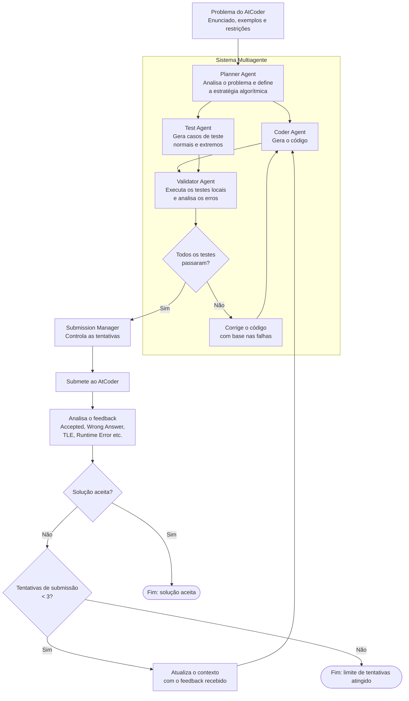

# TAES AtCoder vs LLM

Pipeline para filtrar submissões do AtCoder, baixar código humano, gerar
soluções com LLMs e comparar qualidade com Qodana.

## Estrutura

```text
taes/
├── analysis/    # análise Qodana
├── atcoder/     # download e integração HTTP com AtCoder
├── cli/         # orquestração da pipeline
├── core/        # modelos compartilhados
├── loop/
│   ├── engine/        # execução e grafos
│   ├── integrations/  # AtCoder, LLM e scraping
│   └── validation/    # checagem local de soluções
├── pipeline/    # filtragem e preparação de dados
└── storage/     # CSVs e artefatos persistidos
tests/           # testes automatizados
```

O loop oferece dois fluxos: `default` é o baseline de geração e reparo;
`multiagent` executa o fluxo Planner/Coder/Test/Validator antes da submissão.
Selecione o fluxo com `taes-loop --graph default` ou
`taes-loop --graph multiagent`.

Existe uma única implementação por funcionalidade. Os arquivos antigos na
raiz foram removidos para evitar wrappers e imports duplicados.

## Instalação

```bash
python3 -m venv .venv
source .venv/bin/activate
python -m pip install -e ".[dev]"
```

Configure as credenciais em `.env` usando [`.env.example`](./.env.example).

## Comandos

```bash
taes-pipeline --help
taes-loop --help
taes-qodana --help
```

Fluxo recomendado:

```bash
taes-pipeline filter --csv submissions.csv
taes-pipeline download
taes-pipeline problems
taes-loop
taes-pipeline ai-layout
taes-qodana outputs/02_download \
  --rules-python rules_py.txt \
  --rules-cpp rules_cpp.txt
```

Para executar tudo em sequência:

```bash
taes-pipeline all --raw-csv submissions.csv
```

No `multiagent`, só os exemplos oficiais do enunciado bloqueiam a submissão; os testes gerados pelo
Test Agent não têm gabarito e só geram aviso (vão para o feedback se o AtCoder rejeitar). O CSV de
resultados traz `llm_calls`, `input_tokens` e `output_tokens` por problema, para comparar custo entre grafos.

## Arquitetura do loop



Todos os caminhos padrão ficam centralizados em
[`taes/core/paths.py`](./taes/core/paths.py), e os resultados são gravados em
`outputs/`.

As etapas são seguras para reexecução: downloads já registrados no metadata são
ignorados, o loop retoma problemas aceitos, e CSVs, códigos e logs são
substituídos atomicamente. Assim, uma interrupção não deixa um arquivo final
parcial. Para recalcular uma etapa de filtragem, remova explicitamente seu
arquivo de saída antes de executá-la novamente; para o loop, use `--no-resume`.

## Desenvolvimento

```bash
pytest
ruff check taes tests
python -m compileall -q taes
```

O dataset bruto, credenciais e resultados gerados são locais e não devem ser
versionados.
